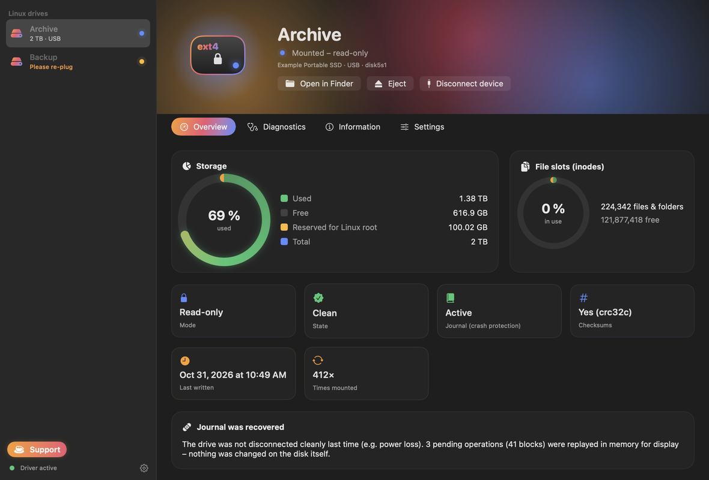
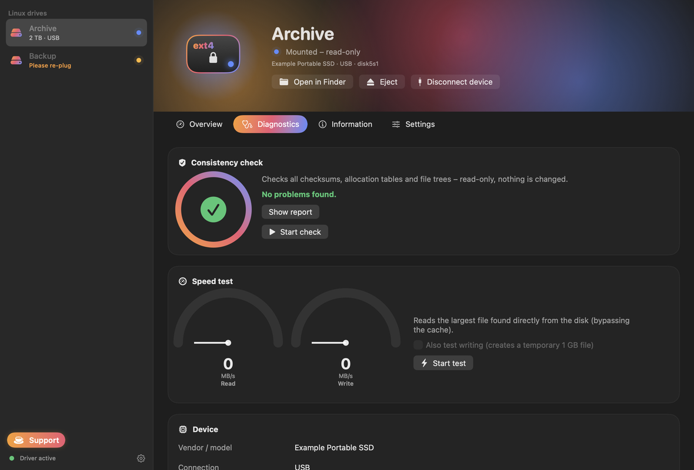
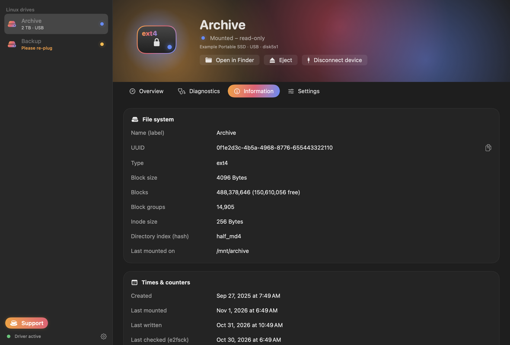

# ExtBridge

**Read and write Linux ext2/ext3/ext4 disks on macOS – as a normal disk in Finder, without kernel extensions, without lowering security.**

ExtBridge is an open source alternative to commercial ext4 drivers for the Mac. It is built on Apple's
[FSKit](https://developer.apple.com/documentation/fskit) (macOS 15.4+) and contains its own ext4
implementation written from scratch in portable C (MIT licensed, no GPL code).

**[⬇ Download the latest release](https://github.com/schnierk/ExtBridge/releases/latest)** ·
[User guide](docs/USER-GUIDE.md) · [Anleitung (Deutsch)](docs/ANLEITUNG.md)



| Diagnostics | Details |
|---|---|
|  |  |

## Installation

1. Download `ExtBridge-<version>.dmg` from the [releases page](https://github.com/schnierk/ExtBridge/releases/latest)
   (signed with a Developer ID and notarized by Apple), open it and drag ExtBridge into Applications.
2. Open ExtBridge. It guides you to **System Settings → General → Login Items & Extensions →
   By Category → File System Extensions** to turn on **ExtBridge ext4** (once).
3. Attach a Linux disk – it shows up in Finder.

Details and troubleshooting: [user guide](docs/USER-GUIDE.md).

## Features

* **Finder integration**: Linux partitions mount automatically when the disk is attached and appear
  like any other external disk (open, copy, rename, delete, Quick Look, …).
* **Native speed for file data**: file contents are moved by the macOS kernel itself
  (FSKit *kernel offloaded I/O*); the driver only tells the kernel where the blocks are.
* **Read and write** on ext4 with the default Linux feature set: `extent`, `64bit`, `flex_bg`,
  `metadata_csum` (crc32c, also `metadata_csum_seed`), `huge_file`, `dir_nlink`, `extra_isize`,
  `dir_index` (hashed directories: legacy/half-MD4/TEA, signed and unsigned), `large_dir`,
  `sparse_super`/`sparse_super2`, `uninit_bg`, `resize_inode`, `ext_attr`.
* **Crash safe**: every metadata change is written through the **jbd2 journal** exactly like Linux
  does. Journals left behind by Linux (unclean shutdown) are replayed; on read-only mounts the replay
  happens in memory only, so the disk is never touched.
* **Read-only support** for everything else: ext2/ext3 (block-mapped files), `inline_data`,
  `bigalloc`, `meta_bg`, `casefold`, `quota`, … – such volumes are mounted read-only automatically
  and the app explains why.
* **Linux semantics kept**: owners/permissions, hard links, symbolic links (fast and slow), sparse
  files, unwritten extents, nanosecond and creation timestamps, open-unlinked files (orphan list),
  extended attributes (macOS attributes are stored as `user.*`, so Linux sees them too).
* **Owner mapping**: files of the Linux user (uid 1000) appear as owned by your Mac user and new
  files get the Linux uid – no permission trouble in either direction.
* **Clean Linux disks**: optionally no `.DS_Store`, `._*`, `.Spotlight-V100`, `.fseventsd` files.
* **App with diagnostics**: animated SwiftUI app and menu bar item – mount/unmount (also read-only),
  usage, health state, journal state, all superblock information, a read-only **consistency scan**
  (checksums, bitmaps, extent trees, directories) and a **speed test**.
* **Never locked out**: before macOS mounts a disk, ExtBridge checks it; a disk with problems is
  mounted read-only (like Linux' `errors=remount-ro`) and the app shows the findings. The check
  includes a full block cross-check against the bitmaps (like e2fsck pass 5).
* **Per-disk settings**: always read-only, no auto-mount.
* **Disk Utility integration**: *First Aid* runs the read-only consistency check
  (`fsck_fskit -t extbridge`), volumes can be renamed in Finder (stored as the ext4 label).

## How it compares to Paragon extFS

| | Paragon extFS 15 | ExtBridge |
|---|---|---|
| Technology | kernel extension (Apple silicon: "Reduced Security" required) | FSKit user-space module, SIP stays on |
| `metadata_csum` (default since e2fsprogs 1.43) | not supported (per vendor page) | read **and write** |
| Journal | – | jbd2 replay + journaled writes (crash tested) |
| Price / license | commercial | free, MIT |

## Requirements

* macOS 15.4 or newer (tested on macOS 26.5, Apple M4); Apple silicon and Intel.
* To build a working copy yourself you need a **paid Apple Developer Program membership**: the
  FSKit entitlement `com.apple.developer.fskit.fsmodule` is restricted and must come from a
  provisioning profile. See [docs/SIGNING.md](docs/SIGNING.md).

## Building

```bash
# core library, command line tool and test programs (Linux or macOS)
make

# macOS app + FSKit extension (needs the Xcode command line tools; signing: docs/SIGNING.md)
macos/build.sh --team TEAMID --identity "Developer ID Application: …" \
    --app-profile ExtBridge.provisionprofile --ext-profile ExtBridgeFS.provisionprofile
```

The `l2m` command line tool works on disk images and raw devices and is useful on its own:

```bash
build/l2m disk.img info          # superblock, features, journal state
build/l2m disk.img tree /        # recursive listing with checksums
build/l2m disk.img verify        # read-only consistency scan
build/l2m -w disk.img put local.txt /dir/remote.txt
```

Without `-w` the device is opened `O_RDONLY` – nothing can be written.

## Testing

`tests/run_all.sh` (Linux, needs e2fsprogs and python3) runs:

* **read compatibility** – 20 kinds of file systems created by `mkfs.ext4 -d` (ext2/3/4, 1k/2k/4k
  blocks, with/without checksums, 64bit, journal, flex_bg, 128-byte inodes, csum seed, large_dir,
  all hash algorithms, inline data, sparse_super2, bigalloc …) must be listed byte-identically,
  and a read-only mount must leave the image bit-for-bit unchanged;
* **write correctness** – a full tree is copied in and thousands of random operations (create,
  write at random offsets, truncate, rename, hard/soft links, xattrs, mass create/delete for
  htree splits, chmod …) are mirrored on the host; afterwards `e2fsck -fn` must find nothing and
  both `l2m` and e2fsprogs' own `debugfs` must see exactly the expected content;
* **big files on fragmented disks** – files with thousands of extents (depth-2 extent trees),
  written the way the macOS kernel does it (map, write, complete – also out of order and in
  pieces), plus targeted cases for full extent leaves;
* **power-loss simulation** – writes are cut at a random point and a random subset of everything
  not yet flushed is dropped (like a disk cache losing power); recovery by ExtBridge *and* by
  `e2fsck` must give a consistent file system whose content equals the state after some prefix of
  the operations;
* **concurrency** – 8 threads hammering one volume (also run under AddressSanitizer, UBSan and
  ThreadSanitizer).

See [docs/TESTING.md](docs/TESTING.md) for details and results.

## Architecture

See [docs/ARCHITECTURE.md](docs/ARCHITECTURE.md).

```
core/        portable ext4 implementation (C11, MIT)          ~5,000 lines
tools/l2m.c  command line tool
tests/       test suite (shell, Python, C)
macos/       FSKit extension (Swift) and app (SwiftUI)
```

## Status and limits

* Version 0.9.1 – public beta. Feature complete for everyday use and extensively tested on disk
  images and real disks; still keep backups of important data. See [CHANGELOG.md](CHANGELOG.md).
* Not supported for writing: ext2/ext3 block-mapped files (read works), `inline_data`, `bigalloc`,
  `quota`, `casefold`, encryption, `ea_inode` (values larger than one block), fast-commit replay.
* FSKit offers no explicit "flush the disk cache" call for raw writes; metadata goes through the
  kernel buffer cache with synchronous writes. Always eject the disk before unplugging it.
* iPhone/iPad: FSKit is macOS only; there is no way for third-party apps to mount ext4 there.
* FSKit modules start with the user session: a disk that is already attached while the Mac boots
  is probed before the module runs and has to be re-plugged once after login (macOS reserves the
  re-probe for itself, not even root can trigger it). ExtBridge detects this, shows a re-plug card
  and, when started at login (Settings → "At login"), posts a notification. Disks that macOS did
  recognise but left unmounted (e.g. after an ExtBridge update) are mounted when the app starts.

## Support

ExtBridge is free. If it saves you a commercial driver licence, you can buy me a coffee – the app
has a button for it, or directly: [PayPal](https://paypal.me/popierk) ·
[Card / Apple Pay](https://buy.stripe.com/aFa00l8Rm1Hl5wbauk1B601).


Bug reports and pull requests are welcome: please include the output of
`log stream --predicate 'subsystem == "de.nexami.extbridge"' --level info` and, if you can, the
result of the app's consistency check. Never attach disk images with private data.

## License

MIT – see [LICENSE](LICENSE). Not affiliated with Paragon Software or Apple.
